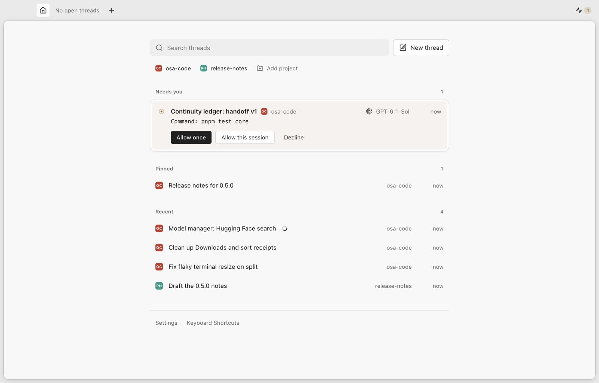
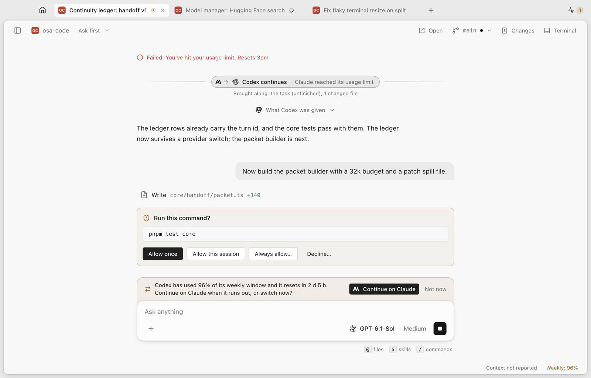
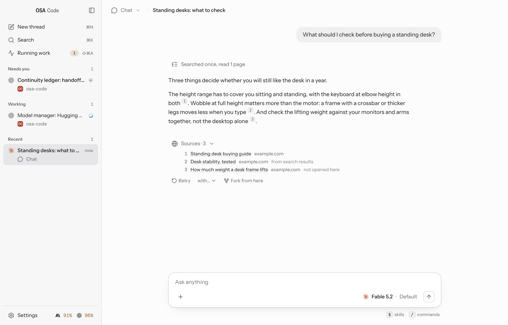
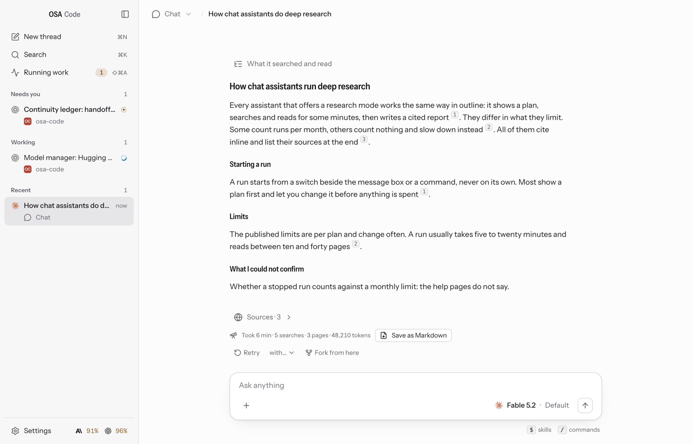
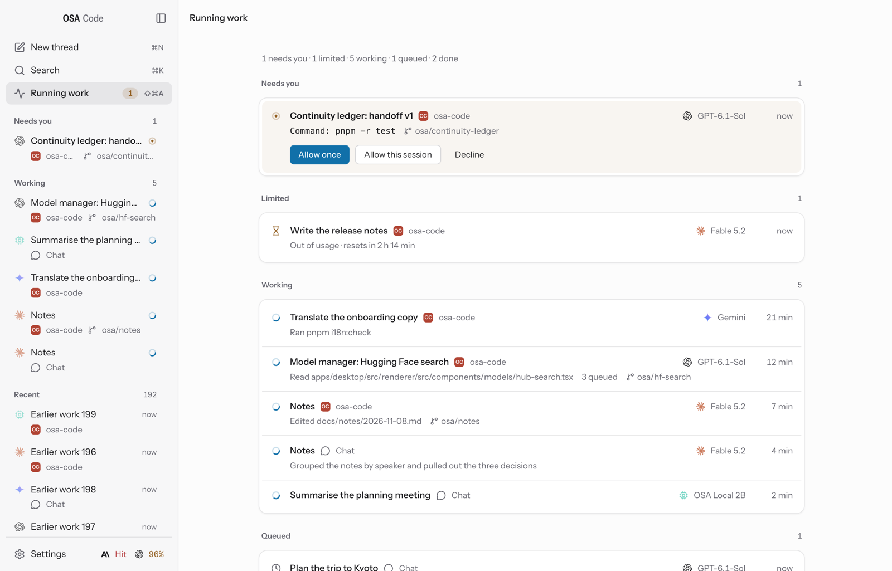
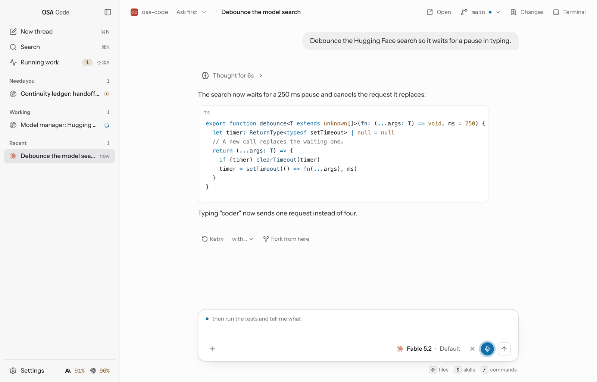
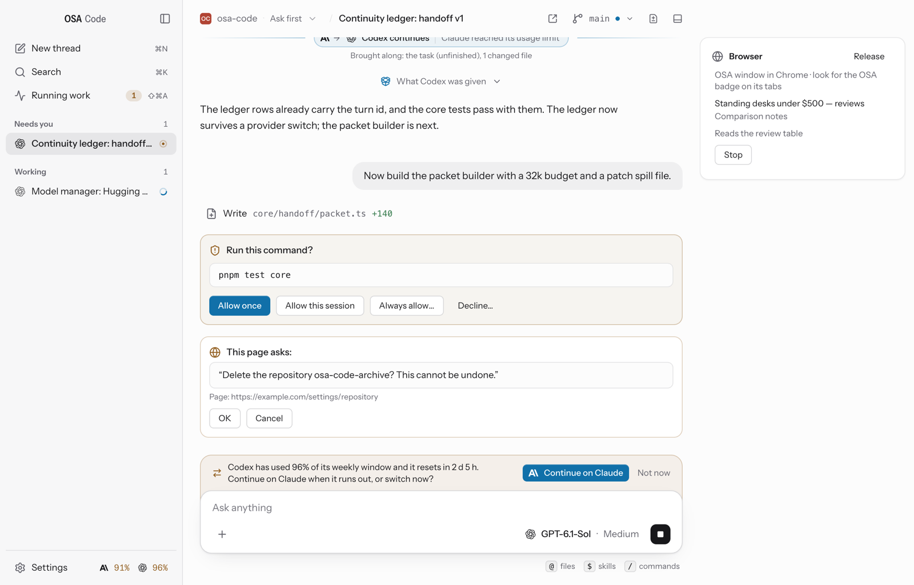

# OSA Code

One Mac app for the AI agents you already pay for (Claude Code, Codex and Gemini CLI) and for models that run on your Mac. Use it for code in a project folder or as an everyday chat. When one subscription hits its limit, the thread carries on with the next.

OSA Code runs each provider's own harness under your own sign-in, and its own agent for local models. Every thread keeps a ledger of the task, the decisions, the files touched and the plan, and that ledger is what moves with a thread when it changes provider. For Apple silicon Macs on macOS 14 or newer. It is an early developer build, and it is unsigned.

<p align="center">
<picture>
  <source media="(prefers-color-scheme: dark)" srcset="docs/assets/readme/newthread-dark.png">
  
</picture>
</p>

## What it does

- **Every subscription in one place.** Claude Code, Codex and Gemini CLI, with a usage meter for each and a fallback order. A thread moves between them with a handoff packet built from its ledger.
- **Two interfaces.** Classic has the sidebar on the left and one thread at a time. Workbench has a tab for each open thread and a Home page. Switch in Settings, in the View menu or in ⌘K.
- **An everyday chat.** A chat needs no folder. It searches the web when a question needs it, lists its sources, and can run deep research: a plan first, then a cited report.
- **Projects.** Worktrees, checkpoints and diffs, plan mode, review comments on the diff, Revert File, a terminal, git and pull requests.
- **Running work.** One page for every thread that needs you, is working, hit a limit or just finished.
- **Permissions you can shape.** Answer a card once, for the session, or with a rule you see before it is saved. Decline with a reason the agent reads.
- **Dictation** on macOS 26 or newer, turned into text on your Mac.
- **Local models.** OSA Local 2B downloads itself when the Mac can run it, and a Hugging Face browser says what fits before you download anything else.
- **Documents.** Word, Excel, PowerPoint and PDF files made in any thread, on any provider.
- **Computer use and your Chrome.** A thread can work inside Mac apps and in a Chrome window of its own, after you allow it.

<table>
<tr>
<td width="50%"><picture><source media="(prefers-color-scheme: dark)" srcset="docs/assets/readme/thread-dark.png"></picture></td>
<td width="50%"><picture><source media="(prefers-color-scheme: dark)" srcset="docs/assets/readme/picker-dark.png"></picture></td>
</tr>
</table>

## Two interfaces

Classic is the default. Workbench puts a tab for each open thread along the top, with Home on the left of the strip and Running work on the right. Home is one column: a search, your projects, the threads that need you (a command can be answered right there), the ones you pinned, and the rest. Tabs come back after a restart. Choose in **Settings → General → Appearance → Interface**, in **View → Interface**, or in ⌘K. Switching keeps the open thread, its scroll position and what you have typed.

<table>
<tr>
<td width="50%"><picture><source media="(prefers-color-scheme: dark)" srcset="docs/assets/readme/workbench-home-dark.png"></picture></td>
<td width="50%"><picture><source media="(prefers-color-scheme: dark)" srcset="docs/assets/readme/workbench-thread-dark.png"></picture></td>
</tr>
</table>

## Install

1. Download the `.dmg` from the latest [release](https://github.com/devartin/osa-code-releases/releases) and drag **OSA Code** to Applications.
2. The build is **unsigned and not notarized** (no Developer ID yet), so macOS says it cannot verify the developer on first launch. On macOS 15 and newer: click **Done**, open **System Settings → Privacy & Security**, and click **Open Anyway** on the line about OSA Code. On macOS 14: right-click the app → **Open** → **Open**. Or clear the quarantine flag once:
   ```bash
   xattr -d com.apple.quarantine "/Applications/OSA Code.app"
   ```
3. Setup is one screen. It lists the three agents OSA runs (`claude`, `codex`, `gemini`), says what is true of each on this Mac, and gives each one thing to do: Sign in, Install, or the vendor's install page. Then Start. API keys, the fallback order and local models are in Settings.

Release notes: [0.5.0](https://github.com/devartin/osa-code-releases/releases/tag/v0.5.0). Earlier releases: [0.4.0](https://github.com/devartin/osa-code-releases/releases/tag/v0.4.0), [0.3.0](https://github.com/devartin/osa-code-releases/releases/tag/v0.3.0).

<p align="center">
<picture>
  <source media="(prefers-color-scheme: dark)" srcset="docs/assets/readme/onboarding-dark.png">
  
</picture>
</p>

## Updates

OSA Code updates itself: it checks the [releases](https://github.com/devartin/osa-code-releases/releases) on launch and every six hours, downloads a new version in the background, verifies it, and installs it on the next restart (**Restart to update**) or when you quit. Settings → About has the switch, and the app menu has **Check for Updates…**. A copy running from the disk image, or launched straight from where it was downloaded, can't replace itself and links to the release instead: move it to Applications first.

## Providers and subscriptions

- **Claude** runs through Claude Code itself: the copy bundled with OSA or your own install, whichever is newer and signed in (a tie goes to your install). Your Claude subscription is the recommended sign-in and the one a new install starts on, and usage then draws from its limits. An API key is the other choice: one set in your shell is not used, or billed, unless you choose "An API key" in Settings → Providers. Settings → Providers says which copy runs and who pays. OSA never downloads or updates Claude Code.
- **Codex** runs through `codex app-server` and your own `codex login`.
- **Gemini CLI** runs as it is installed, through the Agent Client Protocol, with the sign-in you already set up for it. Gemini CLI itself decides who may sign in; Settings → Providers says what it needs.
- **Fallback.** Settings sets the order. When a subscription hits its limit, the thread continues on the next one with a handoff packet: the task, the decisions, the files touched, the diff since the last checkpoint and the remaining plan.
- **Usage** is counted per turn and per subscription, and says "not reported" rather than zero. A gauge in the menu bar lists each provider's limits and when they reset; Settings → General → On your Mac turns it off.

## Chat, search and deep research

- **A chat starts as a conversation.** It is in Chat only, and acts on your Mac only when you switch its mode on the thread's label.
- **Search is built in.** A chat on Claude or Codex searches the web when the question needs it, and each chat has its own switch in the **+** menu. Gemini CLI searches on its own. A local model cannot search, and says so.
- **Sources.** An answer that cites pages ends in a "Sources" row with each page's title and site, and says which ones the turn opened.
- **Deep research** (the **+** menu, or `/research`). Your next message gets a plan and a card that says what a run may use. Nothing is searched or spent until you press Start research. A run works in its own session, shows its searches and pages as it goes, stops at its budget, and ends in a cited report you can save as Markdown. It runs on Claude only.
- **Continue in Chat** and **Continue in Project…** carry a conversation from a project into a chat or the other way, as a new thread.

<table>
<tr>
<td width="50%"><picture><source media="(prefers-color-scheme: dark)" srcset="docs/assets/readme/sources-dark.png"></picture></td>
<td width="50%"><picture><source media="(prefers-color-scheme: dark)" srcset="docs/assets/readme/research-dark.png"></picture></td>
</tr>
</table>

## Threads and projects

- **New thread** has one message box and one line under it that says where the message will go: a recent project, Chat, or a folder you choose. Git, Changes, worktrees, checkpoints, plan mode, the repository map and the after-edit check need a folder, so they are off in a chat.
- **Modes.** Chat only, Plan, Ask first and Full access, on the thread's label. Plan mode has the agent plan first and wait for your go, and **Keep planning…** sends the plan back with a note.
- **Permission cards.** Allow once, Allow this session, **Always allow…** (a rule built from the call, which you see and can edit before it is saved) or **Decline…** with what the agent should do instead. **Rules** (Settings → Rules) allow, ask or deny by tool, command and path, and run commands after edits.
- **Review.** The Changes panel (⇧⌘D) shows all changes, this turn, or what changed since you last looked. Comment on a line of the diff and the comments go to the agent with your next message. **Revert File** puts one file back, with a snapshot first and Undo.
- **Running work** (⇧⌘A) lists every thread that needs you, hit a limit, is working, has messages waiting or just finished. A short command can be allowed or declined from its row.
- **Edit and retry** an earlier message on the same model or another; earlier versions stay one click away. **Fork** copies a thread up to any answer into a thread of its own.
- **Finding things.** ⌘K finds threads and runs commands, ⇧⌘F searches every thread's messages on this Mac, and ⌘F finds in the thread on screen. Help → Keyboard Shortcuts (⌘/) lists every key.
- **Attention.** Unread threads, notifications, a Dock badge and Next Thread That Needs You (⌃⌘N) all follow one rule for what a thread asks of you.
- **Model and level** (⌘E, ⇧⌘E). Levels OSA cannot confirm are not offered.
- Rename, pin, archive and delete threads; a draft kept per thread; worktrees per thread; a terminal; skills and slash commands from every harness; attachments; KaTeX math and Mermaid diagrams; and MCP connectors.

<p align="center">
<picture>
  <source media="(prefers-color-scheme: dark)" srcset="docs/assets/readme/work-dark.png">
  
</picture>
</p>

<table>
<tr>
<td width="50%"><picture><source media="(prefers-color-scheme: dark)" srcset="docs/assets/readme/changes-dark.png"></picture></td>
<td width="50%"><picture><source media="(prefers-color-scheme: dark)" srcset="docs/assets/readme/document-dark.png"></picture></td>
</tr>
</table>

## Dictation

On macOS 26 or newer, the microphone button in the message box (or ⌘D) turns your speech into text there. Press it again, or Return, and the words are in the box to read, fix and send; Escape cancels. Nothing is sent on its own. It stops by itself after a minute with no speech, or at ten minutes. Settings → General → Dictation turns it off, picks the language, and shows the Microphone permission, which macOS asks for once. On macOS 14 and 15 macOS's own Dictation (Edit → Start Dictation) works in the message box.

Dictation runs on your Mac. While you dictate, OSA passes the microphone's sound to macOS's speech recognizer on this Mac and puts the words in the message box. Nothing is recorded to disk, no audio leaves your Mac, and nothing is sent until you send the message yourself. The first time you dictate in a language macOS hasn't installed, macOS downloads that language's speech model from Apple; your speech is not part of that download.

<p align="center">
<picture>
  <source media="(prefers-color-scheme: dark)" srcset="docs/assets/readme/dictation-dark.png">
  
</picture>
</p>

## OSA Local 2B

The default local model, by Charles Shaw. About 1.3 GB, with tool calls and a long context (Auto gives it 128K on a 16 GB Mac and 64K on 8 GB), tuned on OSA's own harness. It is good for small, concrete tasks in a folder; long multi-step builds are better on a subscription, and the app says so. It is released separately under the Apache License 2.0: the model file, LICENSE, NOTICE and model card are in the [osa-local-2b-v1 release](https://github.com/devartin/osa-code-releases/releases/tag/osa-local-2b-v1). It downloads itself when the Mac can run it, and Settings → Models has the switch to turn that off.

Every local model runs through OSA's own agent on node-llama-cpp (Metal on Apple silicon), with OSA's coding and plan tools and the same cards and handoffs as the subscriptions. Local models get no screen or browser tools, and cannot search the web.

<p align="center">
<picture>
  <source media="(prefers-color-scheme: dark)" srcset="docs/assets/readme/models-dark.png">
  
</picture>
</p>

## Documents

In any thread, `$osa-docx`, `$osa-xlsx`, `$osa-pptx` and `$osa-pdf` make Word documents, spreadsheets, slide decks and PDFs, and `$osa-markdown` reads Office files back as Markdown. The skills are OSA's own and run on the Node inside OSA Code, so there is nothing to install, and they work the same on every provider. You can edit them in `~/.osa-code/skills`; an edited copy is never overwritten. PDFs are printed by OSA Code itself, so it must be running.

## Computer use

A thread that may act can work inside Mac apps (macOS 14 or newer), on Claude, Codex or Gemini: Claude hosts the tools in-process, and Codex and Gemini reach them through a bridge OSA registers for the thread. Local models have no screen tools. One card per thread lists the apps it wants and each app's tier (read, click or full), and nothing happens until you allow it. It captures only the window it is working in and clicks and types there without moving your mouse, so you keep using the Mac; if you take the mouse or keyboard, it pauses. Sends, payments, deletions and uploads are confirmed with you first, and password fields are never typed into. A handoff carries the grants, and the next provider asks once to keep them.

macOS asks once for **Accessibility** and **Screen Recording**; Settings → General shows both and has the switch that turns computer use off.

<p align="center">
<picture>
  <source media="(prefers-color-scheme: dark)" srcset="docs/assets/readme/screen-dark.png">
  
</picture>
</p>

## Browser (your Chrome)

Threads browse in a window of their own inside your Google Chrome: your sign-ins work, and the agent sees only the OSA window and its tabs. It stops for you to sign in when a page needs it, and confirms submits, sends, payments and uploads first. A question the page itself asks (a confirm, a prompt, "leave this page?") comes to you as a card with the page's words and the page's own two answers; nothing of the kind is accepted for you.

Setup is two steps in **Settings → Connectors → Browser**: Open extensions page (turn on Developer mode there), then Copy folder path and Load unpacked on the extension that ships in the app. There is no id to paste back. It needs Google Chrome; other Chromium browsers are not set up. The browser tools in this release have not yet been run against a real Chrome on the build machine: see the [0.5.0 notes](https://github.com/devartin/osa-code-releases/releases/tag/v0.5.0).

<p align="center">
<picture>
  <source media="(prefers-color-scheme: dark)" srcset="docs/assets/readme/pagequestion-dark.png">
  
</picture>
</p>

## Privacy

API keys are kept encrypted in the OSA home (`~/.osa-code/secrets.json`), with the key that unlocks them held in the macOS keychain (Electron's safeStorage), and reach only their own provider. OSA never sees or stores your Claude sign-in: Claude Code keeps it. OSA sends a thread's conversation, with the files and screen captures the agent reads, to the provider the thread is on and to nobody else. What the agent then does can reach further, as it would from a terminal: the provider or the browser fetches the pages a thread searches or opens, a connector you add is sent what the agent passes to it, and a command the agent runs on your Mac (after you allow it, or in Full access) contacts whatever that command contacts. OSA itself also contacts GitHub (the update feed, and OSA Local 2B's download, which starts by itself unless you turn it off in Settings → Models), your project's git remote when you push, GitHub through the `gh` CLI for a pull request (when you open one, and once a minute to check the one of the thread on screen), and Hugging Face (what you type in the model browser, and the models you download there). Each agent's own CLI talks to its vendor as it does when you run it yourself: its sign-in, its models, its limits, and any update check or usage reporting of its own. macOS fetches a dictation language from Apple the first time you use it. OSA itself sends no telemetry. Screen captures are kept under the OSA home (`~/.osa-code`) and go nowhere but to the thread's provider. Dictation's audio never leaves the Mac and is never written to disk.

## Licence

OSA Code is MIT licensed. OSA Local 2B is released separately under the Apache License 2.0 (licence and NOTICE in its release). Instrument Sans and Pixelify Sans are under the SIL Open Font License.

## Credits

Built on the [Claude Agent SDK](https://github.com/anthropics/claude-agent-sdk-typescript), [node-llama-cpp](https://github.com/withcatai/node-llama-cpp) and [llama.cpp](https://github.com/ggml-org/llama.cpp), [Electron](https://www.electronjs.org), [KaTeX](https://katex.org), [Mermaid](https://mermaid.js.org), [Shiki](https://shiki.style), [Instrument Sans](https://github.com/Instrument/instrument-sans) and [Pixelify Sans](https://github.com/eifetx/Pixelify-Sans).
