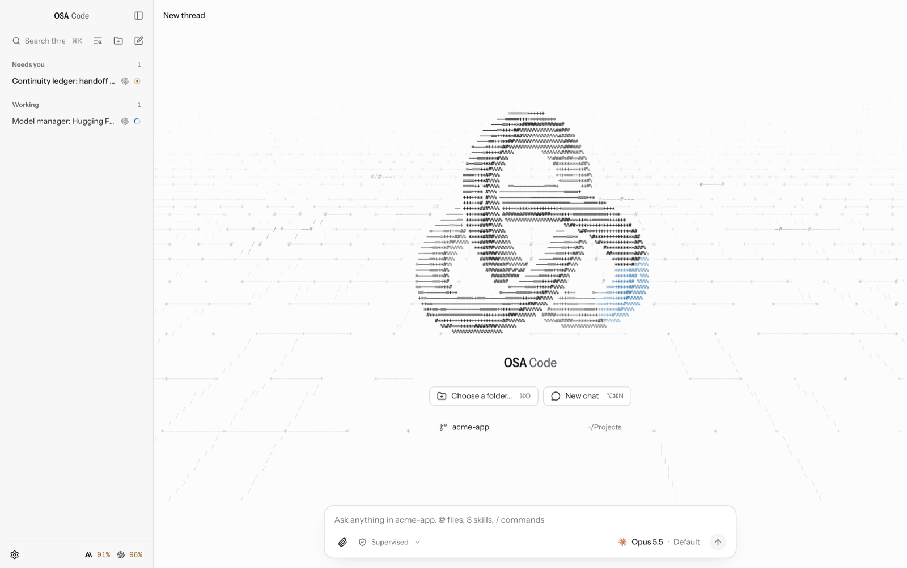
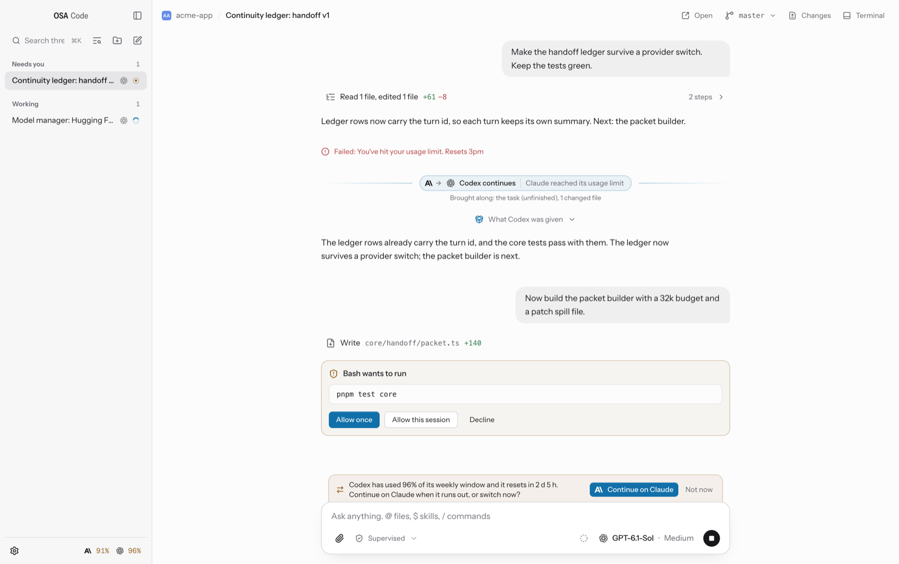
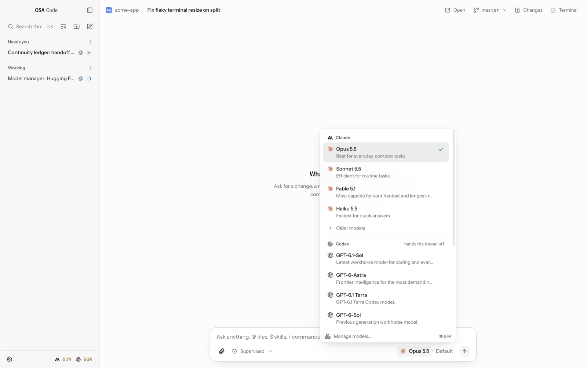
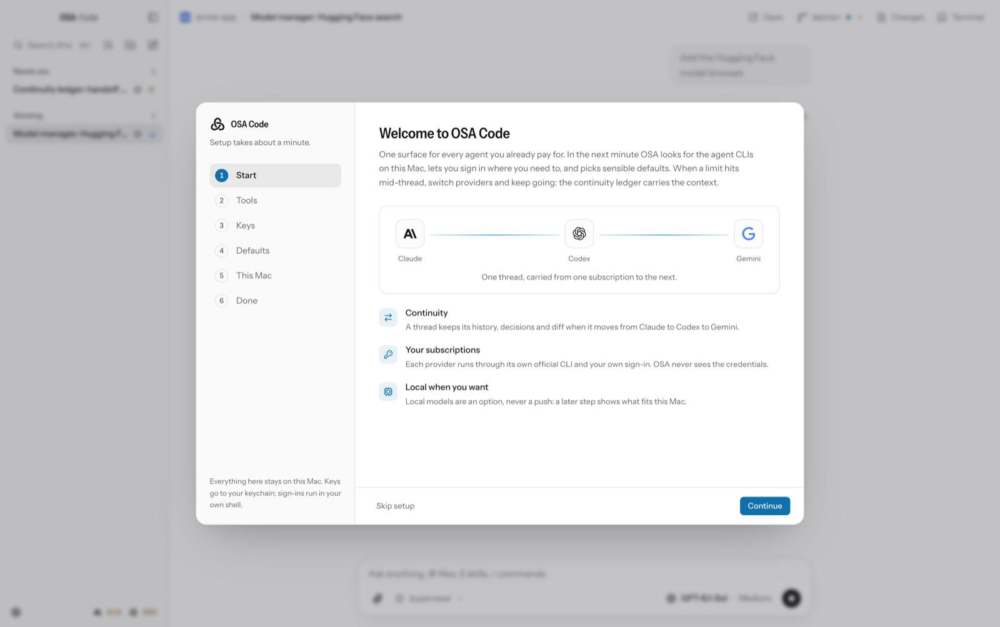
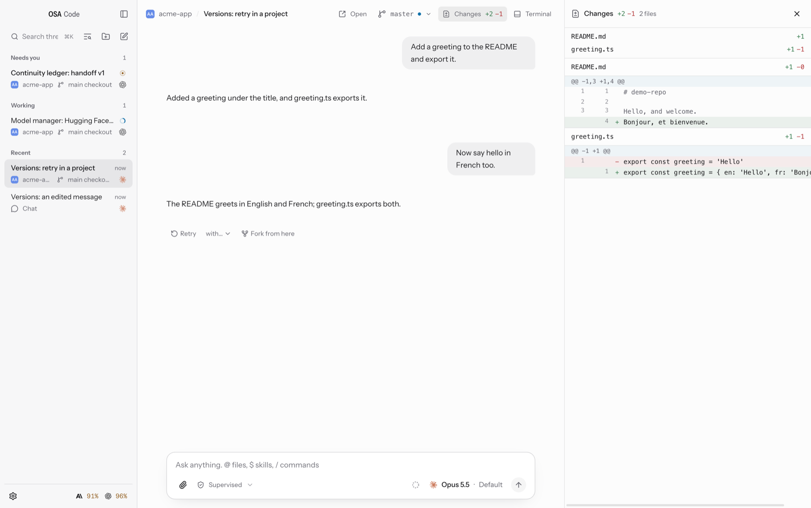
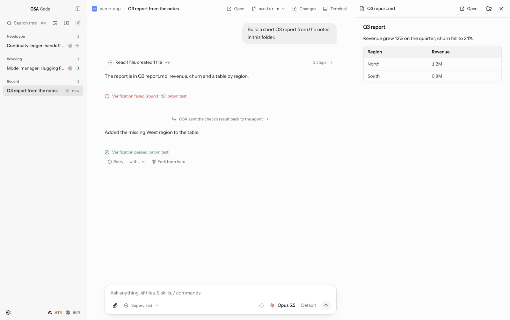
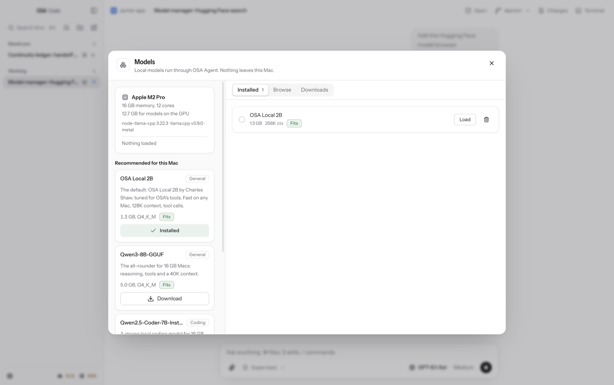
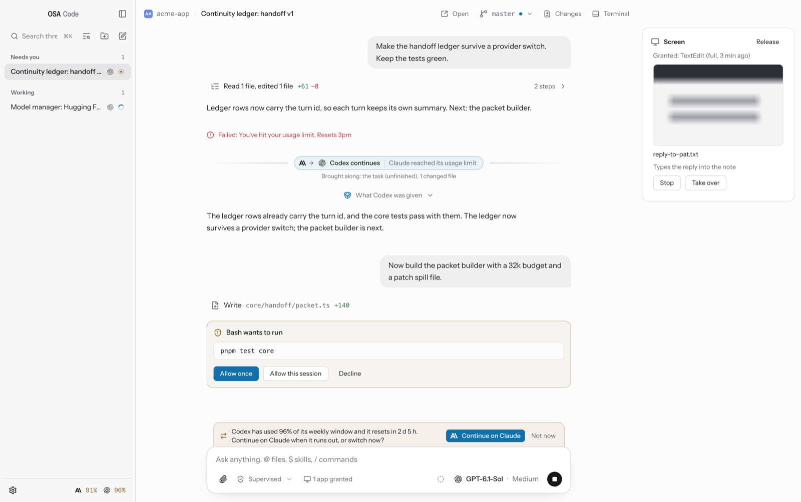

# OSA Code

One Mac app for the AI coding agents you already pay for, plus local models, with one continuity ledger that moves a thread to the next provider when a limit hits.

OSA Code runs the official harnesses under your own sign-ins (Claude Code, Codex, Gemini CLI and other ACP agents) and its own agent for local models. Every thread keeps a ledger of the task, the decisions, the files touched and the plan, so when one subscription runs out the next provider picks up from where it stopped. For Apple silicon Macs on macOS 14 or newer.

<p align="center">
<picture>
  <source media="(prefers-color-scheme: dark)" srcset="docs/assets/readme/newthread-dark.png">
  
</picture>
</p>

## Features

- **Every subscription, one surface.** Claude Code, Codex, Gemini and any Agent Client Protocol agent, with usage meters per subscription and a fallback order. A thread moves between them with a handoff packet built from its ledger.
- **OSA Local 2B and other local models.** The default local model downloads itself when the Mac can run it; a Hugging Face browser says what fits before you download anything else.
- **Threads and chats.** Projects or folder-free chats, plan mode, edit and retry with versions, fork, search, Rules for permission cards, and a repository map.
- **Documents.** Word, Excel, PowerPoint and PDF files made in any thread, on any provider, with Open and Preview.
- **Computer use.** A thread can work inside Mac apps without taking your mouse or keyboard, after you allow each app.
- **Browser (your Chrome).** Threads browse in a window of their own inside your Chrome: your sign-ins work, and the agent sees only its own tabs.

<table>
<tr>
<td width="50%"><picture><source media="(prefers-color-scheme: dark)" srcset="docs/assets/readme/thread-dark.png"></picture></td>
<td width="50%"><picture><source media="(prefers-color-scheme: dark)" srcset="docs/assets/readme/picker-dark.png"></picture></td>
</tr>
</table>

## Install

1. Download the `.dmg` from the latest [release](https://github.com/devartin/osa-code-releases/releases) and drag **OSA Code** to Applications.
2. The build is **unsigned and not notarized** (no Developer ID yet), so macOS says it cannot verify the developer on first launch. On macOS 15 and newer: click **Done**, open **System Settings → Privacy & Security**, and click **Open Anyway** on the line about OSA Code. On macOS 14: right-click the app → **Open** → **Open**. Or clear the quarantine flag once:
   ```bash
   xattr -d com.apple.quarantine "/Applications/OSA Code.app"
   ```
3. The setup wizard finds the agent CLIs on your PATH (`claude`, `codex`, `gemini`, …), lets you sign in to each from a built-in terminal, takes API keys if you use them, and suggests local models that fit your Mac.

Release notes: [0.4.0](https://github.com/devartin/osa-code-releases/releases/tag/v0.4.0).

<p align="center">
<picture>
  <source media="(prefers-color-scheme: dark)" srcset="docs/assets/readme/onboarding-dark.png">
  
</picture>
</p>

## Updates

OSA Code updates itself: it checks the [releases](https://github.com/devartin/osa-code-releases/releases) on launch and every six hours, downloads a new version in the background, verifies it, and installs it on the next restart (**Restart to update**) or when you quit. Settings → About has the switch, and the app menu has **Check for Updates…**. A copy running from the disk image, or launched straight from where it was downloaded, can't replace itself and links to the release instead: move it to Applications first.

## Providers and subscriptions

- **Claude** runs through Claude Code itself: the copy bundled with OSA or your own install, whichever is newer and signed in (a tie goes to your install), with your own Claude Code sign-in or an API key. On the sign-in, usage draws from your Claude subscription limits. Settings → Providers says which copy runs; OSA never downloads or updates Claude Code.
- **Codex** runs through `codex app-server` and your own `codex login`.
- **Gemini CLI** and other agents that speak the Agent Client Protocol run as they are installed.
- **Fallback.** Settings sets the order. When a subscription hits its limit, the thread continues on the next one with a handoff packet: the task, the decisions, the files touched, the diff since the last checkpoint and the remaining plan.
- **Usage** is counted per turn and per subscription, and says "not reported" rather than zero.

## Threads and chats

- **New thread** starts in a project folder or as a chat with no folder. A chat gets the same thread view, streaming, usage and handoff. Git, Changes, worktrees, checkpoints, plan mode, the repository map and the after-edit check need a folder, so they are off in a chat.
- **In a project:** plan mode has the agent plan first and wait for your go before it edits anything, and the repository map gives the agent an outline of the project.
- **Rules** (Settings → Rules) answer permission cards by tool and path, and run commands after edits.
- **Edit and retry** an earlier message on the same model or another; earlier versions stay one click away.
- **Fork** copies a thread up to any answer into a thread of its own.
- **Search (⇧⌘F)** finds words in every thread on this Mac, and **⌘K** finds threads and runs commands.
- **Model and level** (⌘E, ⇧⌘E). Levels OSA cannot yet confirm are marked unverified.
- Worktrees per thread, checkpoints and diffs, a terminal, git and pull requests, skills and slash commands from every harness, attachments, KaTeX math and Mermaid diagrams, and MCP connectors.

<table>
<tr>
<td width="50%"><picture><source media="(prefers-color-scheme: dark)" srcset="docs/assets/readme/changes-dark.png"></picture></td>
<td width="50%"><picture><source media="(prefers-color-scheme: dark)" srcset="docs/assets/readme/document-dark.png"></picture></td>
</tr>
</table>

## OSA Local 2B

The default local model, by Charles Shaw. About 1.3 GB, with tool calls and a long context (Auto gives it 128K on a 16 GB Mac and 64K on 8 GB), tuned on OSA's own harness. It is released separately under the Apache License 2.0: the model file, LICENSE, NOTICE and model card are in the [osa-local-2b-v1 release](https://github.com/devartin/osa-code-releases/releases/tag/osa-local-2b-v1). It downloads itself when the Mac can run it, and Settings → Models has the switch to turn that off. Copies of the previous default already downloaded stay selectable.

Every local model runs through OSA's own agent on node-llama-cpp (Metal on Apple silicon), with the same tools, cards and handoffs as the subscriptions.

<p align="center">
<picture>
  <source media="(prefers-color-scheme: dark)" srcset="docs/assets/readme/models-dark.png">
  
</picture>
</p>

## Documents

In any thread, `$osa-docx`, `$osa-xlsx`, `$osa-pptx` and `$osa-pdf` make Word documents, spreadsheets, slide decks and PDFs, and `$osa-markdown` reads Office files back as Markdown. The skills are OSA's own and run on the Node inside OSA Code, so there is nothing to install, and they work the same on every provider. You can edit them in `~/.osa-code/skills`; an edited copy is never overwritten. PDFs are printed by OSA Code itself, so it must be running.

## Computer use

A thread in build mode can work inside Mac apps (macOS 14 or newer), on any provider: Claude hosts the tools in-process, and Codex, Gemini and other ACP agents reach them through a bridge OSA registers for the thread. One card per thread lists the apps it wants and each app's tier (read, click or full), and nothing happens until you allow it. It captures only the window it is working in and clicks and types there without moving your mouse, so you keep using the Mac; if you take the mouse or keyboard, it pauses. Sends, payments, deletions and uploads are confirmed with you first, and password fields are never typed into. A handoff carries the grants, and the next provider asks once to keep them.

macOS asks once for **Accessibility** and **Screen Recording**; Settings → General shows both and has the switch that turns computer use off.

<p align="center">
<picture>
  <source media="(prefers-color-scheme: dark)" srcset="docs/assets/readme/screen-dark.png">
  
</picture>
</p>

**Browser (your Chrome).** Turn it on in Settings → Connectors → Browser, load the extension that ships in the app (Settings names the folder), and paste its id back. The agent sees only the OSA window and its tabs, stops for you to sign in when a page needs it, and confirms submits, sends, payments and uploads first.

## Privacy

API keys are stored in the macOS keychain through Electron's safeStorage and reach only their own provider. OSA never sees or stores your Claude credentials. Nothing leaves the Mac except to the provider you chose for a thread, the update feed on GitHub, and the model files you choose to download. Screen captures stay under the OSA home (`~/.osa-code`).


## Licence

OSA Code is MIT licensed. OSA Local 2B is released separately under the Apache License 2.0 (licence and NOTICE in its release). Instrument Sans is under the SIL Open Font License.

## Credits

Built on the [Claude Agent SDK](https://github.com/anthropics/claude-agent-sdk-typescript), [node-llama-cpp](https://github.com/withcatai/node-llama-cpp) and [llama.cpp](https://github.com/ggml-org/llama.cpp), [Electron](https://www.electronjs.org), [KaTeX](https://katex.org), [Mermaid](https://mermaid.js.org), [Shiki](https://shiki.style) and [Instrument Sans](https://github.com/Instrument/instrument-sans).
